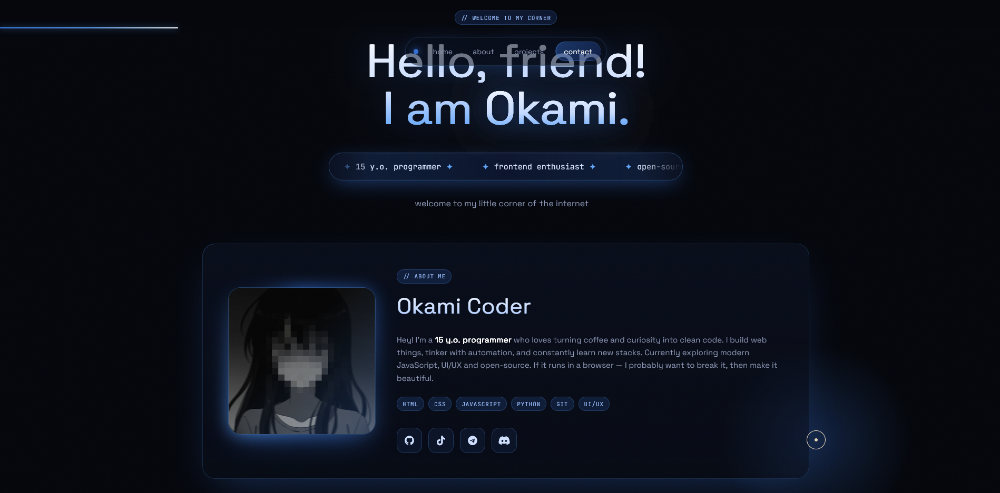

<p>
   
</p>
# 🌐 Okami-s-Web-Site

My portfolio website, showcasing my skills and contact information 💻

## 🔗 Link to the live site
👉 **[View the portfolio in person](https://OkamiCoder.github.io/Okami-s-Web-Site/)**

## 🛠️ Technologies used in the development
*   **HTML5** - semantic structure and accessibility (A11y).
*   **Tailwind CSS & CSS3**  - modern, adaptive, and fast styling.
*   **Vanilla JavaScript** - interactive elements and interface logic.

## 🚀 Project Features
- Fully responsive (Mobile First) design for all screen sizes.
- Optimized images for fast loading.
- Configured semantic SEO framework.

## 📂 How to run locally
1. Clone the repository:
   ```bash
   git clone https://github.com/OkamiCoder/Okami-s-Web-Site
   ```
2. Open the `index.html` file in your browser (or use Live Server in VS Code).
